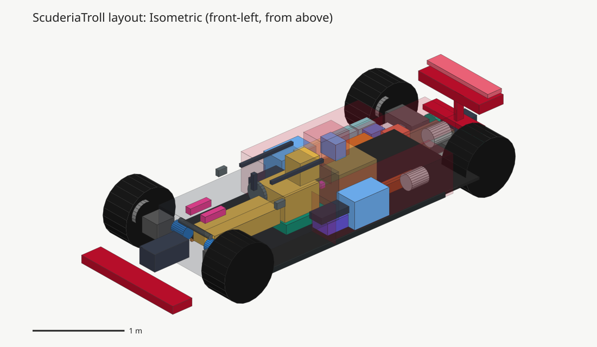

# ScuderiaTroll

A fictional open-wheel racing series and the concept car designed for it, the **ScuderiaTroll ST67**. The rulebook is deliberately permissive, and the ST67 leans into it: an opposed-piston diesel hybrid with a Brabham BT46B-style fan sucking it to the track.

Not a real car. Nobody knows what Alloy X is.

## The Rules

- **[Technical Regulations](TechnicalRegulations.md):** 3 to 6 wheels, a 5.5 × 2.0 × 1.2 m size box, no pure battery-electric cars (some alternative fuel must drive the car), exhaust cleaner than EPA Tier 4 locomotive limits, no push-to-pass buttons, and total design freedom for everything else, including fan cars, sliding skirts, and active suspension.
- **[Sporting Rules](SportingRules.md):** A 3-swap cap shared by tyre and engine-map changes, mix-and-match tyre compounds, DRS, Overtime Shootouts, and a set of named clauses (Leclerc, George, Verstappen, Hamilton, Hayes, and more) for strategy blunders, repeat offenders, and officiating mistakes.

## The Car: ST67

| | |
| --- | --- |
| Engine | 3.2 L opposed-piston two-stroke diesel on renewable HVO, two-stage electric turbos |
| Hybrid | Parallel; 450 kW electric (one motor per front wheel plus a rear motor), 45 kg battery |
| Power | ~1,350 hp (55% diesel / 45% electric) |
| Aero | Underfloor fans + sliding skirts + ground-effect tunnels; DRS is the only driver-operated device |
| Suspension | Fully active electromechanical, with passive springs as a fail-safe |
| Mass | ~862 kg with driver (no fuel), 45/55 front/rear, ~0.31 m CG height |
| Grip | ~4.0 G at 100 km/h (about double F1), ~5.0 G at 250 km/h |
| Performance | 0–100 km/h ~2.0 s, top speed ~375 km/h (~400 km/h with DRS) |

## Blueprints

| Document | Covers |
| --- | --- |
| [powertrain.md](blueprints/powertrain.md) | Engine, hybrid system, Alloy X, gearing, performance, and the full design review |
| [aftertreatment.md](blueprints/aftertreatment.md) | Exhaust catalysts and filters sized for the emissions rule |
| [cooling.md](blueprints/cooling.md) | Heat loads, cooling loops, radiators, inlets, and louver control |
| [aero.md](blueprints/aero.md) | Fan-assisted ground effect, skirts, downforce schedule, drag, DRS |
| [suspension.md](blueprints/suspension.md) | Active suspension layout, actuator sizing, control, and failure modes |
| [tyres.md](blueprints/tyres.md) | Load-rated tyre selection and race strategy |
| [weight-budget.md](blueprints/weight-budget.md) | Component-by-component mass and every weight-saving round |
| [layout.md](blueprints/layout.md) | Packaging, weight distribution, and the 3D model |

## 3D Model

[blueprints/model/](blueprints/model/) holds a primitive model of the ST67 (every component is a box or cylinder with its real mass):

- `scuderiatroll_model.py`: run it in Blender to build the car, or with plain `python3` to print the mass and CG report and regenerate the files below.
- `scuderiatroll.obj` / `.mtl`: import directly into Blender or any 3D tool.
- `preview_*.svg`: isometric, top, side, and front views.
