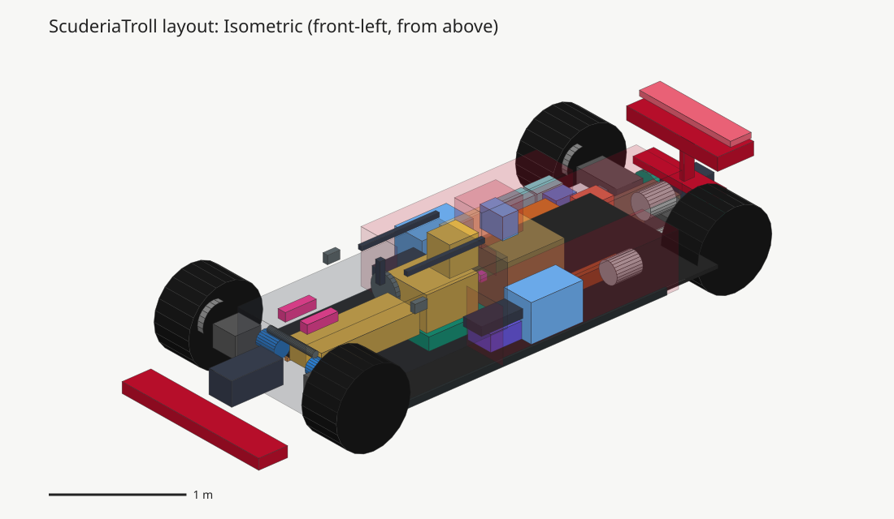
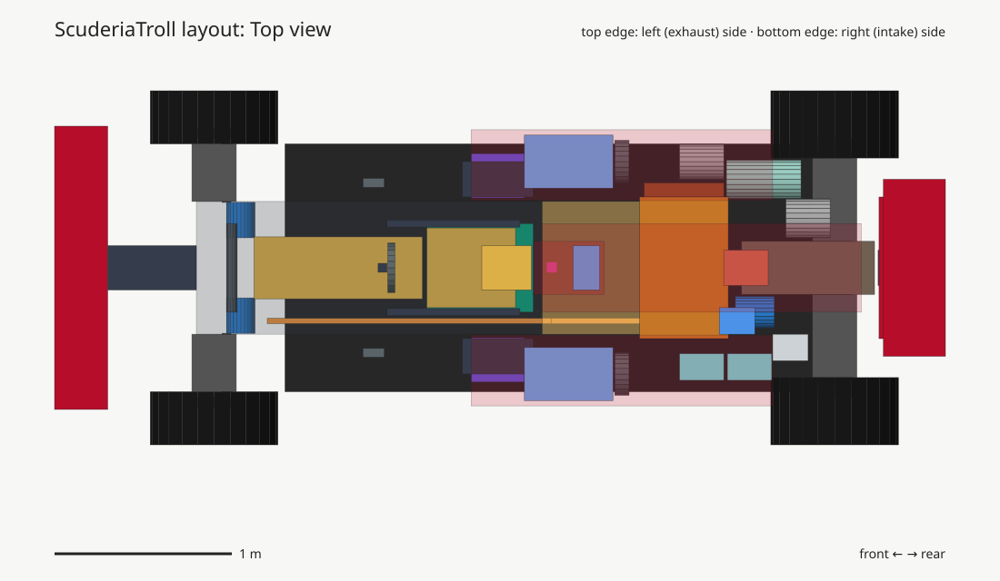
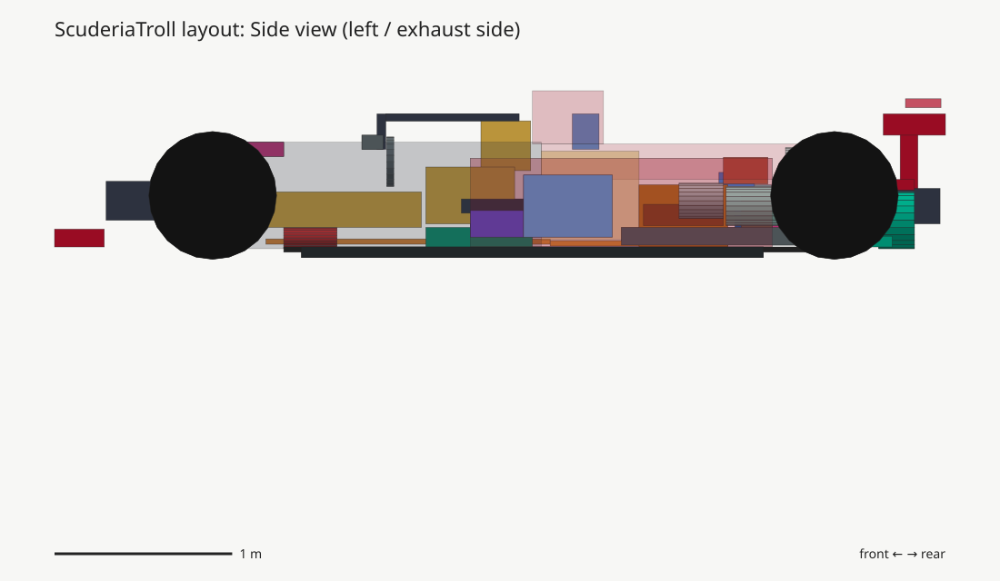
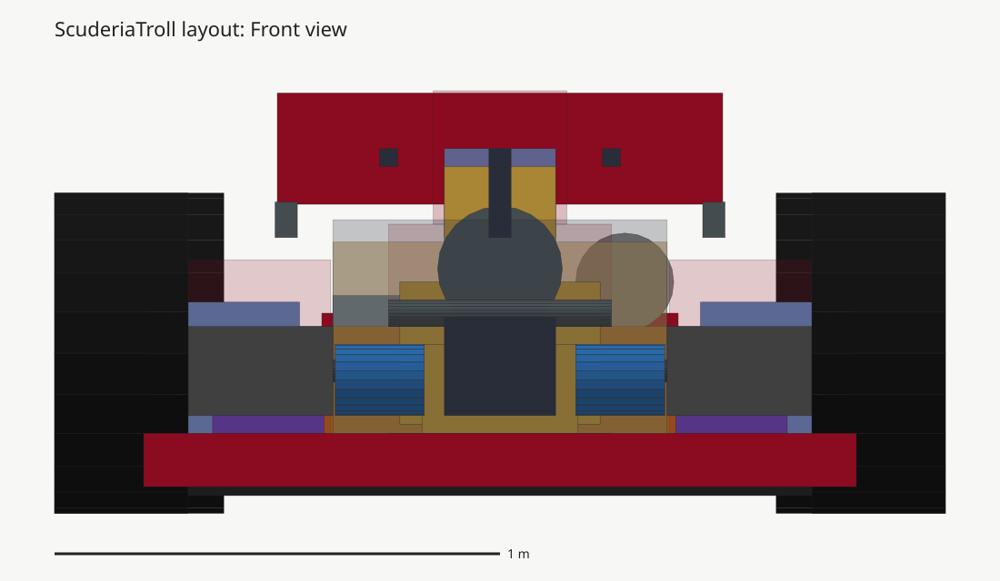

# Layout (Rough)

First-pass packaging layout for the ScuderiaTroll ST67, placing every item from [weight-budget.md](weight-budget.md) to estimate weight distribution and centre of gravity (CG). Very rough: positions are to ~0.1 m.

## 3D Model

The layout is defined as a primitive 3D model: every component is a box or a cylinder with its real mass. The model script is the source of truth for component sizes and positions.

- **[model/scuderiatroll_model.py](model/scuderiatroll_model.py):** Component list (size, position, mass, colour) plus builders.
  - **In Blender:** Scripting workspace → open the file → Run Script (or `blender --python scuderiatroll_model.py`). Builds every component as a separate object in per-system collections, with materials and a `mass_kg` custom property.
  - **Without Blender:** `python3 scuderiatroll_model.py` prints the mass and CG report and regenerates the OBJ and preview images.
- **[model/scuderiatroll.obj](model/scuderiatroll.obj) + [.mtl](model/scuderiatroll.mtl):** Ready to import into Blender (File → Import → Wavefront OBJ) or any 3D tool, one object per component.

Coordinates (metres, right-handed): **x** rearward from the front axle centreline (rear axle at x = 3.5 m), **y** toward the car's right side, **z** up from the ground. The magenta cube marks the CG.

### Colour Key

| Colour | Components |
| --- | --- |
| Red (translucent) | Sidepods, engine cover, airbox |
| Red (solid) | Front wing, rear wing main plane, beam wing |
| Pink | Rear wing DRS flap |
| Green cylinders (rear) | Underfloor fans and fan duct ([aero.md](aero.md)) |
| Near-black strips | Sliding skirts along the floor edges |
| Magenta-pink boxes | Active suspension spring/actuator units ([suspension.md](suspension.md)) |
| Dark slate | Monocoque (translucent), halo, crash structures |
| Yellow | Driver |
| Orange | OP4 engine |
| Brown | Gearbox |
| Grey cylinders | HP and LP turbos |
| Pale teal cylinder | Aftertreatment |
| Blue cylinders | MGU-Ks (front pair and rear) |
| Green | Battery |
| Light blue | Radiators and battery cooling core |
| Cyan | Charge-air coolers |
| Amber (translucent) | Fuel cell |
| Purple | Electronics |

## Key Dimensions

| Dimension | Value | Technical Rule 3 limit |
| --- | --- | --- |
| Wheelbase | 3.5 m | ≤ 3.6 m (two-axle) |
| Overall length | ~5.0 m (front wing tip to rear crash structure) | ≤ 5.5 m |
| Overall width | 2.0 m (outer tyre faces; 380 mm fronts, 405 mm rears) | ≤ 2.0 m |
| Track (centre to centre) | ~1.62 m front, ~1.60 m rear | |
| Overall height | ~0.95 m (top of airbox) | ≤ 1.2 m |

## Packaging

- **Exhaust on the left, intake on the right:** The opposed-piston engine has its exhaust ports at one end of each cylinder and intake ports at the other. The left (exhaust) side carries the exhaust manifold, HP turbo, inter-stage aftertreatment, and LP turbo; the right (intake) side carries the charge-air coolers, DEF tank, and rear inverter.
- **Engine:** Cylinders horizontal and transverse, crankshafts running fore-aft along each side. Only ~0.35 m tall with its centre at ~0.25 m, which allows the low engine cover. It's ~0.8 m wide across the crankshafts, so the sidepod radiators sit forward of it rather than beside it.
- **Gearbox:** 6-speed, behind the engine, with the rear MGU-K on its input.
- **Battery:** Low and central beneath the driver's seat, keeping its 50 kg near the floor.
- **Fuel cell:** ~115 L, between the driver and the engine.
- **Front motors:** Inboard either side of the footwell, driving the front wheels through short driveshafts and sharing space with the front suspension. Similar packaging has been done on front-motor Le Mans prototypes.
- **Cooling:** HT and LT radiators in the sidepods, with ducts from their exits to the underfloor fans for low-speed airflow; the battery cooling core sits in the airbox ([cooling.md](cooling.md)).

## Results

From the model's mass report:

| Metric | Car + driver (862 kg) | Race start (960 kg) | F1 reference |
| --- | --- | --- | --- |
| CG position (x) | 1.92 m behind front axle | 1.95 m | |
| Front / rear weight split | **45.0 / 55.0** | **44.3 / 55.7** | Recent F1 regulations mandate roughly 44–46% front |
| CG height | **~0.31 m** | ~0.31 m | ~0.30 m (commonly cited estimate) |
| Left-right CG offset | ~3 mm toward the exhaust (left) side | ~1 mm | Negligible |

The underfloor fans at the rear pulled the split ~0.6% rearward; at race start it sits near the bottom of the F1 window. Moving the battery ~0.3 m forward would recentre it (see Tuning Levers).

- **Weight split lands in the F1 window without ballast.** The front motors near the front axle and the battery under the seat pull weight forward, balancing the engine, gearbox, and turbos at the rear.
- **CG height matches F1 despite ~94 kg more mass.** The low opposed-piston engine and the floor-mounted battery offset the extra mass. Raising the engine to a typical V6 centre height (~0.38 m) would lift the whole car's CG by ~18 mm.
- **Fuel burn barely moves the balance:** The fuel cell sits close to the CG, so the split moves less than 1% from race start to finish.
- **Left-right balance:** The exhaust-side hardware (~40 kg) is mostly offset by the intake-side hardware and the rear MGU-K.

### Tuning Levers

- **Battery position:** Moving the 50 kg battery 0.3 m shifts the split by ~0.5%.
- **Wheelbase:** Stretching to the 3.6 m limit gives more room for the fuel cell and sidepods, at some cost to agility.

## Open Items

1. ~~Radiator core area and inlet sizing~~ **Done:** ~0.26 m² of stacked LT/HT core and a ~0.13 m² inlet per sidepod ([cooling.md](cooling.md)).
2. ~~Front suspension packaging~~ **Done:** front spring/actuator units sit on top of the monocoque, leaving the low front bulkhead for the motors; driveshafts pass between the wishbones ([suspension.md](suspension.md)).
3. ~~Aero surfaces~~ **Concept done:** fan-assisted ground effect with sliding skirts ([aero.md](aero.md)); detailed floor, tunnel, and diffuser shapes still open.
